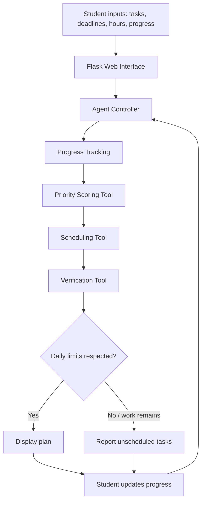

# StudyPilot Development Schema

## Objective
Create a study planning agent that prioritises tasks, schedules work, and verifies the resulting plan.

## Architecture

## Agent cycle
1. **Observe:** receive task names, deadlines, importance, estimated hours, and completed hours.
2. **Decide:** rank tasks using importance, urgency, and remaining workload.
3. **Act:** invoke the scheduling function to allocate study sessions.
4. **Verify:** check daily hour limits and find outstanding unscheduled work.
5. **Respond:** show the schedule and warnings so the student can adjust inputs and run the agent again.

## Priority formula
`score = 2 × importance + 10 / (days_until_deadline + 1) + 0.2 × remaining_hours`

This is a transparent heuristic, not a trained model.

## Components
- `app.py`: agent functions and Flask routes.
- `templates/index.html`: interactive task form and results.
- `static/style.css`: responsive visual design.
- `requirements.txt`: Python dependency.
- `README.md`: setup and usage guide.

## Validation
The verification tool checks that no day's allocated hours exceed the configured daily limit and lists work remaining after the scheduler has allocated sessions.

## Limitations
The planner uses a greedy scheduling heuristic and does not guarantee optimal scheduling. It has no external LLM, calendar integration, or persistent database.
